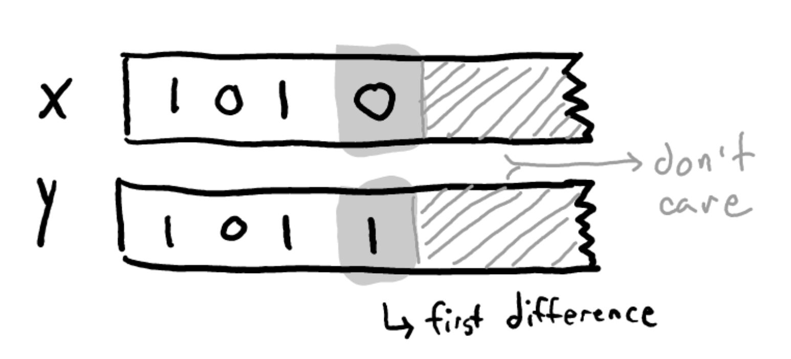
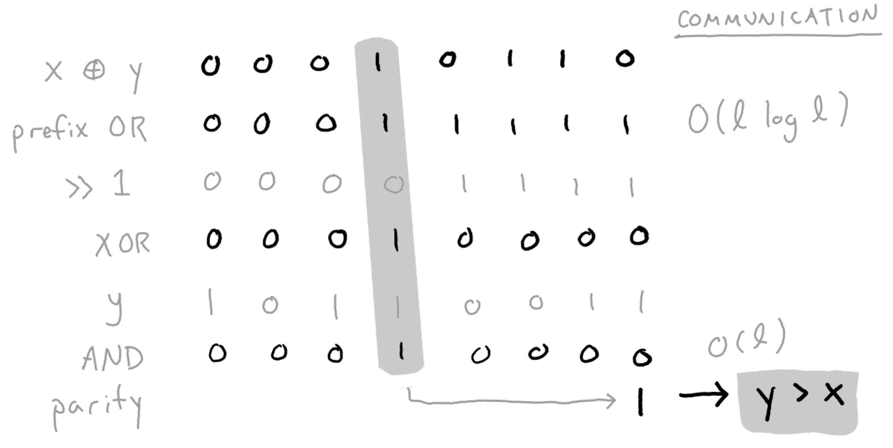
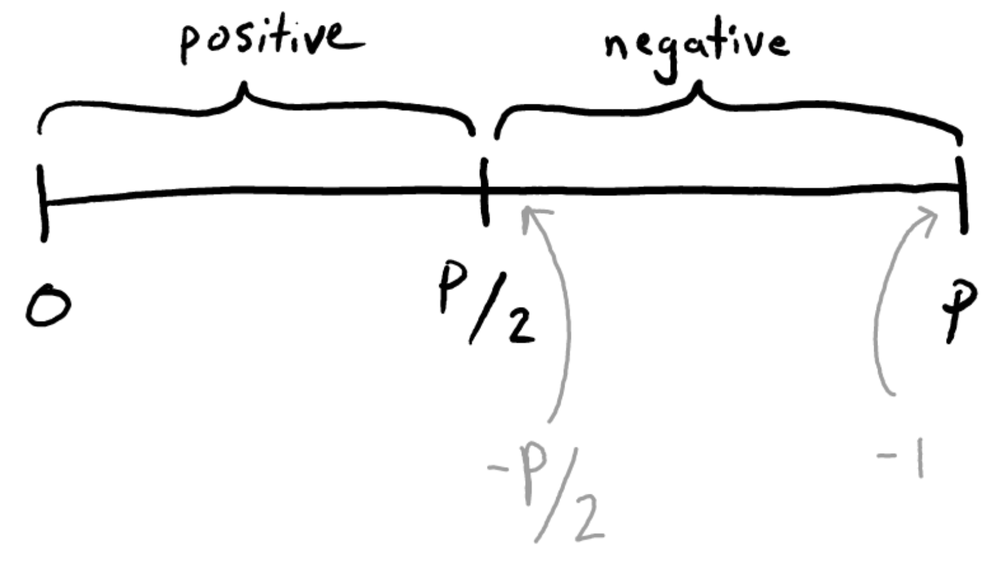
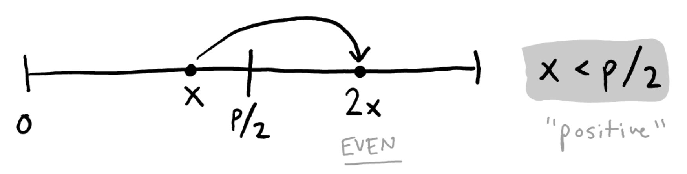
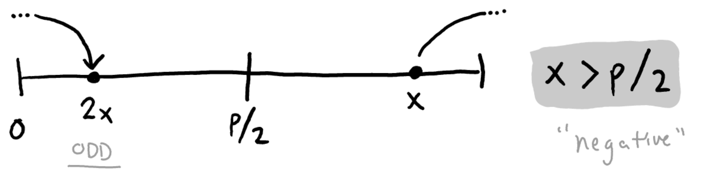
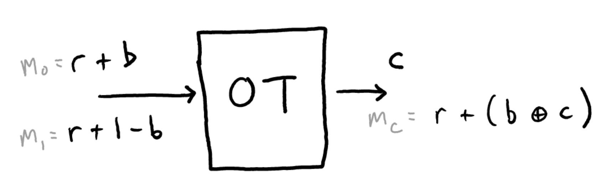
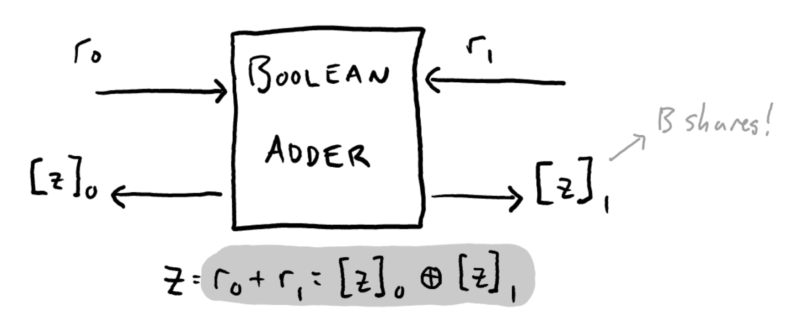
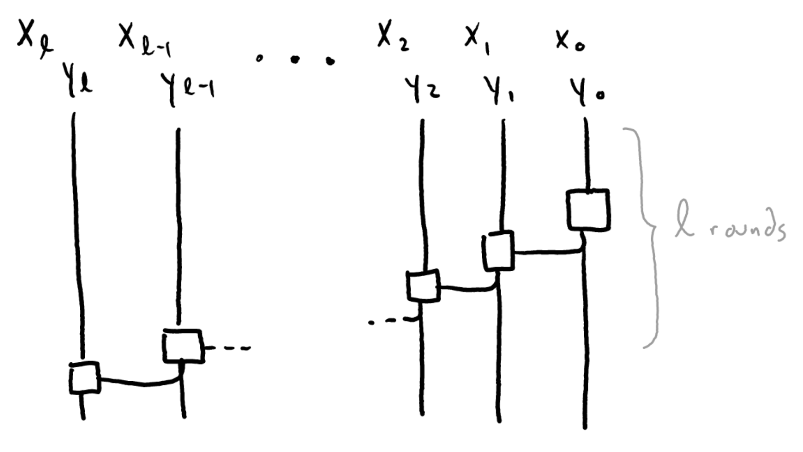
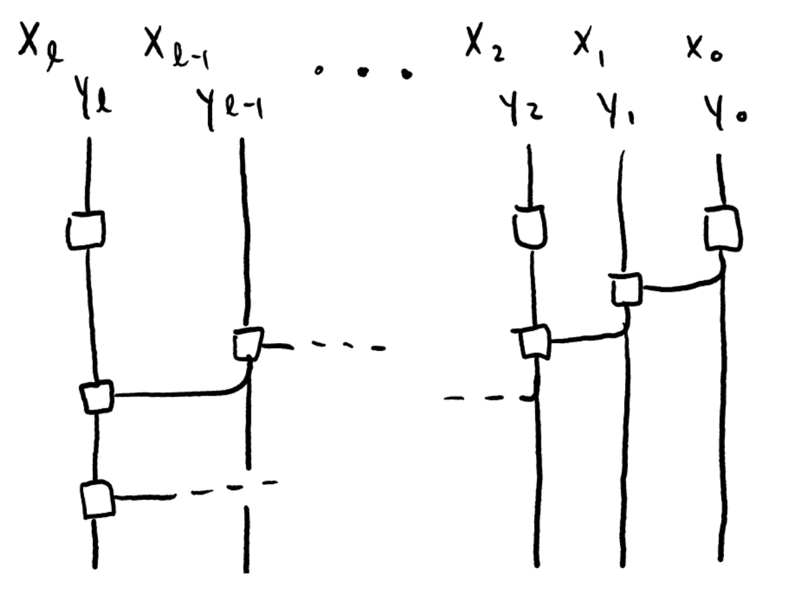



One of the fundamental tasks in modern oblivious computation is the lowly integer comparison gate: for example, they are the major bottleneck in [oblivious sorting][orq], and are just as important for implementing non-linear layers in privacy-preserving machine learning. On this page I want to look at some techniques for oblivious comparisons, inspired by our recent implementation efforts.

Comparing two numbers is also probably one of the earliest problems discussed in MPC: [Yao's Millionaires' Problem][yao] ([pdf][yao_pdf]) is brought up in the introduction of basically every MPC paper and textbook (as of this writing, Google Scholar counts eight thousand citations).

[orq]: 
[yao]: https://doi.org/10.1109/SFCS.1982.38
[yao_pdf]: https://crysp.uwaterloo.ca/courses/pet/W11/cache/www.cs.wisc.edu/areas/sec/yao1982-ocr.pdf

## yao's solution

The answer to the millionaires' problem presented by Yao is exponential in both time and space. I have slightly edited the protocol from Yao's original presentation for clarity.

Suppose Alice and Bob hold $$a,b\in[0,n)$$, respectively, with $$n$$ some small integer, and security parameter $$\lambda$$. Alice generates a public-key encryption keypair $$(\mathrm{pk}, \mathrm{sk})$$ and publishes $$\mathrm{pk}$$.

1. Bob samples a random integer $$r\overset\$\gets[0,2^\lambda)$$, and sends Alice the value $$s:=\mathsf{Enc}(\mathrm{pk}, r) - b$$.[^fn_map] The encryption function outputs random values which mask $$b$$.

2. Alice performs trial decryption. Let

    $$
    y_u := \mathsf{Dec}(\mathrm{sk}, s + u)\quad\forall u\in[0, n).
    $$

    She generates a random prime $$p$$ with $$\lambda/2$$ bits and computes

    $$
    z_u = y_u\bmod p
    $$

    If any $$z_u$$ differ by less than 2 (that is, there exists $$u\neq v$$ such that $$\vert z_u-z_v\vert< 2$$), sample a new prime $$p$$ and regenerate $$\{z_u\}$$.

3. Alice sends the following[^seq] to Bob:

    $$
    (p, w:=[z_0, z_1, z_2, \dots, z_a, z_{a + 1}+1, \dots, z_{n-1} + 1])
    $$

4. Bob checks whether $$w[b]\equiv r\bmod p$$. If yes, he concludes $$a \geq b$$. Otherwise, $$a < b$$.

5. Bob tells Alice the answer.

[^fn_map]: Assume the encryption function maps messages from $$[0,2^\lambda)\to[0,2^\lambda)$$. 

[^seq]: Yao's original paper seems to have a typo; he has Alice send $$\dots,z_a, z_a+1,z_{a+1}+1,\dots$$, which would allow Bob to easily learn $$a$$ by looking for two values which differ by 1. See, e.g., [Fischer's notes](https://zoo.cs.yale.edu/classes/cs467/2012s/course/lectures/ln22.pdf).

Clearly, this is very inefficient. It is not even clear why it is correct! First, let's check what happens if $$b \leq a$$:

$$
\begin{align}
w[b] &= z_b \equiv y_b &\bmod p\\
&\equiv \mathsf{Dec}(\mathrm{sk}, s + b)\\
&\equiv \mathsf{Dec}(\mathrm{sk}, \mathsf{Enc}(\mathrm{pk}, r) - b + b)\\
&\equiv \mathsf{Dec}(\mathrm{sk}, \mathsf{Enc}(\mathrm{pk}, r) + 0)\equiv r
\end{align}
$$

But when $$b > a$$, we instead have

$$
\begin{align}
w[b] &= z_{b}+1\equiv y_b + 1 &\bmod p\\
&\equiv \mathsf{Dec}(\mathrm{sk}, s + b) + 1\\
&\equiv \mathsf{Dec}(\mathrm{sk}, \mathsf{Enc}(\mathrm{pk}, r) - b + b) + 1\\
&\equiv \mathsf{Dec}(\mathrm{sk}, \mathsf{Enc}(\mathrm{pk}, r) + 0)+1\equiv r + 1\\
&\not\equiv r & \square
\end{align}
$$

Since all $$z_u$$ differ by two or more, it is not possible for $$z_b+1$$ to collide with some other $$z_{b'}$$.

To support length $$k$$ inputs, we need $$n\approx 2^k$$, with Alice sending $$O(n)$$ bits to Bob and computing $$O(n)$$ decryptions -- so the entire protocol is exponential in $$k$$. This is also clearly only semihonest (though Yao proposes some modifications to support malicious security).

Needless to say, the literature has improved on this result substantially. (We may want to support comparisons for billionaires, for example!)

## boolean comparisons

The standard approach nowadays -- if boolean secret sharing is available -- is to use an efficient circuit decomposition. (This is what we [implemented in ORQ][orq-cmp].)

[orq-cmp]: https://github.com/elimbaum/orq/blob/d2c1094b4ba053ad3a555ce8954d14c03b1ef39e/include/core/operators/circuits.h#L299

Suppose we want to compare two $$k$$-bit integers $$x, y\in\mathbb Z_{2^k}$$, and are given boolean shares $$[x],[y]$$ (such that $$x=\bigoplus [x]_i$$, $$y=\bigoplus [y]_i$$). Observe that if $$x\neq y$$, then they differ in at least one bit position. Call the largest bit-index of such a difference $$\delta$$ (where index 0 is the least significant bit). When $$x>y$$, $$x[\delta]=1$$ and $$y[\delta]=0$$; when $$x<y$$, the reverse is true. At a high level, our algorithm will:

1. Compute $$s=x\oplus y$$;
2. Find the first occurrence $$\delta$$ of 1 in $$s$$ (that is, the first bit location where $$x$$ and $$y$$ differ);
3. If $$x[\delta]=1$$, return `>`. Otherwise, return `<`.

{: style="max-width: 20em"}

How can we obliviously find the first occurrence of a 1 in a secret-shared bitstring? [Prefix-sum to the rescue][prefix] (specifically, prefix bitwise-OR)![^pfx]

[prefix]: https://www.cs.cmu.edu/~guyb/papers/Ble93.pdf
[^pfx]: With efficient prefix circuits like Blelloch's, this can be done in $$O(\log k)$$ rounds and $$O(k)$$ total bandwidth. Practically, we found that a $$O(\log k)$$-round, $$O(k \log k)$$ [construction][bit-same] was more optimal for data-movement reasons in this specific case, but elsewhere (oblivious aggregations, boolean addition) other topologies win out.

[bit-same]: https://github.com/elimbaum/orq/blob/d2c1094b4ba053ad3a555ce8954d14c03b1ef39e/include/core/containers/b_shared_vector.h#L194

$$
p = \mathsf{prefixOR}(s)\ \implies\ p[i] = p[i + 1] \vee s[i]
$$

So, starting from the most-significant bit, $$p$$ will consist of a string of zeros until the first nonzero bit of $$s$$. Then it will be all ones for the rest. Finally, we XOR $$p$$ and a shifted copy of itself to identify the "edge":

$$
\begin{align}
q &= p \oplus (p \gg 1)\\
q[i] &= p[i] \oplus p[i + 1] \\
\end{align}
$$

Next, we establish the inequality: if $$x>y$$, then $$q\land x\neq 0$$, since $$q[\delta]=x[\delta]=1$$; otherwise, $$x\leq y$$ (either $$x=y$$, so $$q=0$$, or $$x<y$$, so $$y[\delta]=1$$ and $$x[\delta]=0$$). Finally, we compute the parity of the resulting string (which can be done locally, and even very efficiently [in hardware][popcnt]); we know there will be at most a single set bit. This is the result of our comparison.

[popcnt]: https://en.wikipedia.org/wiki/Hamming_weight#Processor_support

Overall, the main cost of the construction is the prefix-OR circuit. There's also some additional handling for signed integers which I have omitted in the above discussion; see our full paper or the code linked above for more details.

## arithmetic comparisons in a prime-order field

This is all well and good, if you have a boolean sharing and a fast prefix-OR circuit. But very often we prefer to work with arithmetic sharings (conversions, while possible, are usually expensive). Over a prime-modulus field, there is an absolutely marvelous technique due to Takashi Nishide and Kazuo Ohta, published at [PKC'07][no07], (and later improved upon by [Catrina & de Hoogh][cdh]) which is the whole reason I wanted to post this writeup in the first place.

[no07]: https://doi.org/10.1007/978-3-540-71677-8_23

The starting point is the trivial observation that

$$
x > y \implies x - y > 0
$$

Under additive secret-sharing schemes, subtraction is cheap, so comparing two integers reduces to checking the sign of their difference[^fn_overflow] (incidentally, this is how most hardware [implements comparisons][neg_flag]).

[neg_flag]: https://en.wikipedia.org/wiki/Negative_flag

[^fn_overflow]: We do need to be somewhat careful here: the difference between two signed integers can overflow the space of representable values, so we will eventually need some additional checks.

How do we learn the sign of an integer (that is, its most significant bit)? Take a two's-complement-adjacent view of some large field $$\mathbb F_p$$ for prime $$p$$: assign the "non-negative numbers" to the bottom half of the field $$[0,\lfloor p/2 \rfloor]$$, and the "negative numbers" to the top half $$[\lceil p/2 \rceil, p)$$, under the map $$-x \mapsto p - x$$. As with the standard two's complement representation, we have $$x + (-x) \equiv x + (p - x) = p \equiv 0$$. Thus, we can represent values in $$(-p/2, p/2)$$.

{: style="max-width: 25em"}

Consider what happens if we _double_ an input $$x$$:

$$
x\mapsto 2x\equiv \begin{cases}
2x & \text{if } 0 \leq x < p/2\\
2x - p & \text{otherwise}
\end{cases}
$$

And now we can easily distinguish between the two cases: if $$x$$ was in the positive region, it will be even (least significant bit 0), but in the negative region, modular wraparound --- $$p$$ is odd --- means it will become odd (LSB 1)! This is a pretty neat trick: we have reduced extraction of the MSB to calculation of the LSB.

### full generality

To properly handle overflow, we can't just look at the sign of $$x-y$$: we also need to consider the existing signs of $$x$$ and $$y$$. Here's the full truth table (taken from [NO'07][no07], Table 2). $$*$$ means we don't care.

| $$\mathsf{sgn}(x)$$ | $$\mathsf{sgn}(y)$$ | $$\mathsf{sgn}(x-y)$$ | $$x \mathop\square y$$ |
| :-: | :-: | :-: | :-: |
| $$+$$ | $$+$$ | $$+$$ | $$>$$
| $$+$$ | $$+$$ | $$-$$ | $$<$$
| $$+$$ | $$-$$ | $$*$$ | $$>$$
| $$-$$ | $$+$$ | $$*$$ | $$<$$
| $$-$$ | $$-$$ | $$+$$ | $$>$$
| $$-$$ | $$-$$ | $$-$$ | $$<$$

So, for example, if $$x=p/2+1$$ and $$y=p/2-1$$, we need to report that $$x<y$$, even though this is not true in the full field $$\mathbb F_p$$. 

Let $$\eta_x,\eta_y,\eta_{x-y}$$ represent whether $$x,y,x-y$$ are negative, $$\bmod p$$, respectively. Formally,

$$
\eta_x = \begin{cases}
1 & x \in [p/2,p)\\ 0 & \text{otherwise}
\end{cases}
$$

Analyzing the truth table, we see that

$$
\begin{align}
(x < y) &\iff \eta_x\eta_y\eta_{x-y}\oplus\eta_x(\neg \eta_y)\oplus(\neg \eta_x)(\neg \eta_y)\eta_{x-y}\\
&=\eta_x\eta_y\eta_{x-y}\oplus\eta_x\oplus \eta_x\eta_y\oplus(\neg \eta_x)(\neg \eta_y)\eta_{x-y}\\
&=\eta_{x-y}(\eta_x\eta_y\oplus(\neg \eta_x)(\neg \eta_y))\oplus \eta_x \oplus \eta_x\eta_y\\
&=\eta_{x-y}(1\oplus \eta_x\oplus\eta_y)\oplus \eta_x(1 \oplus\eta_y)\\
&=\dots\text{arithmetize}\dots\\
&=\eta_{x-y}(1 - \eta_x - \eta_y + 2\eta_x\eta_y) + \eta_x - \eta_x\eta_y
\end{align}
$$

> Arithmetization just means that we evaluate boolean gates as arithmetic expressions.
>
> $$
> \begin{align}
> x \land y &\equiv x\cdot y\\
> x \lor y &\equiv x + y - xy\\
> x \oplus y &\equiv x + y - 2xy\\
> \neg x = 1 \oplus x &\equiv 1 - x
> \end{align}
> $$
>
> That's one (full-width) multiplication gate per (single-bit) boolean gate. Each share can _only_ store 0 or 1. Obviously, we lose the local-evaluation property of XOR gates. No one said this was the most efficient --- but it sometimes beats share conversions.

By first computing the product $$\eta_x\eta_y$$, this expression only requires one additional multiplication. ($$2\eta_x\eta_y$$ is a multiplication by a constant and locally computable.)

So how do we compute $$\eta_x=\mathsf{sgn}(x)$$?

### preprocessed bit decompositions

Like many other questions in multiparty computation, the answer is preprocessing. We'll need a particular kind of correlation:

$$
([r], ([r_0], [r_1], \dots, [r_\ell])):r_i\in\{0,1\}\;\text{and}\;r=\sum_i 2^i r_i
$$

That is, a sharing of a random value $$r$$, as well as sharings of _each of its bits_. All sharings are taken $$\bmod p$$.

Now to check $$[x<0]$$:
1. Compute $$m=\mathsf{open}([x]+[r])$$. Since $$r$$ is random and not known to any party in the clear, it information-theoretically masks $$x$$.
2. Now check if $$m<[r]$$ using the (arithmetized) boolean comparison circuit from above:

    $$
    m<r\implies x+r<r \implies x<0
    $$

Is this really any better? We just avoided a boolean comparison circuit with some nice algebra and... an arithmetized version of a boolean comparison circuit. But the real benefit is that we _no longer need a bit decomposition_ or share-conversion of values in the online phase. Instead, all "dual sharing" happens in preprocessing (or asynchronously), and does not depend on the input whatsoever.

### constructing correlations

So we need a dual-mode sharing of a random value. Where do we get this from?

Suppose we have a magic box in the sky that can generate random sharings (over some large field) of only _zero or one_. Composing $$\ell=\lceil\log_2 p \rceil$$ such correlations together, we can construct a sharing of $$[r]\in\mathbb F_p$$ along with a shared vector $$[\vec b]$$ of length $$\ell$$, such that

$$
\sum_{i=0}^{\ell-1} b_i \cdot 2^i \equiv r \bmod p
$$

Each individual shared bit correlation is identical. With $$\ell$$ such correlations, we can (locally) multiply each by the appropriate $$2^i$$ and sum.

$$
b_0 + b_1 \in \{0,1\} \implies 2^i\cdot b_0 + 2^i \cdot b_1 \in \{0,2^i\}\bmod p
$$

It would (intuitively) seem that generating shared bit correlations is easier than generating full dual-mode sharings. However, it is not yet clear to me how to do so. And since shared bits imply dual-mode sharings non-interactively, dual sharings can actually be no harder.

Another way to look at it: a two party shared bit correlation generator...
- gives some random value $$r_0$$ to Alice;
- and, with uniform probability, either gives Bob $$-r_0$$ or $$1-r_0$$.

Importantly, neither party should know whether Bob got the former or the latter sample.

***This is just a string oblivious transfer![^ot]*** Alice samples $$r_0$$ for herself, and sets her inputs to the oblivious transfer as $$(r_0 + b, r_0 + 1 - b)$$, for some uniform choice of $$b\in\{0,1\}$$. Bob also provides his choice bit $$c\in\{0,1\}$$, and receives back his share $$r_1$$:

$$
\begin{align*}
r_1&=r_0 + c\cdot(1 - b) + (1-c)\cdot b \\
&= r_0 + c - bc + b - bc\\
&= r_0 + b + c - 2bc\\
&= r_0 + (b \oplus c)\\
r_1-r_0 &= b\oplus c
\end{align*}
$$

[^ot]: I didn't actually understand it as such until writing this up! For months I was trying to hunt down silent constructions for various flavors of OLE. It turns out the (non-)answer was staring at me the whole time.

So we're back where we started: an additive (well, subtractive) sharing of an XOR-shared bit. Each string OT requires $$O(\ell)$$ communication, and we need $$\ell$$ of them: so while the protocol is constant (1) round, it requires quadratic communication, $$O(\ell^2)$$.

Obviously, this is a semi-honest protocol only. Alice has ample opportunity to cheat. 

### doing better with boolean adders

Rather than doing a cheap addition and an expensive conversion, we can turn this on its head and do an _expensive_ addition with cheap (free) conversion! For an $$n$$-party MPC, each party $$P_i$$ samples a random $$r_i$$. Then, we parse each as a secret-shared value $$S_i$$, with $$P_{j\neq i}$$ holding a value of zero.

$$
\begin{array}{rlcccr}
S_0 =& (r_0 & 0 & 0 & \cdots & 0)\\
S_1 =& (0 & r_1 & 0 & \cdots & 0)\\
S_2 =& (0 & 0 & r_2 & \cdots & 0)\\
& & & & \ddots \\
S_{n-1} =& (0 & 0 & 0 & \cdots & r_{n-1})
\end{array}
$$

Interpreted as boolean shares, each is just a secret sharing of $$r_i$$, which can be input into a (tree of) boolean adder circuit(s). The output of these adders will be a _boolean sharing_ of the sum!

Here's what the two-party case looks like. Our adder circuit computes $$z=r_0+r_1$$ under boolean secret sharing, so:

{: style="max-width: 30em"}

We can use either a ripple-carry adder (RCA; $$O(\ell)$$ bandwidth and rounds)...

{: style="max-width: 30em"}

...or a parallel prefix circuit (PPA; as good as $$O(\log \ell)$$ rounds)...

{: style="max-width: 25em"}
_just a sketch, sorry_

In general, $$n$$-party sharings will require $$O(n)$$ additions, but with certain sharing schemes (e.g., honest majority) we can get by with fewer. With clever parallelism, we only need $$\log n$$ iterations to execute all additions (since unrelated circuits can operate independently), so our overall round complexity is something like $$O(\log n \log \ell)$$ (assuming a PPA) with bandwidth $$O(n\ell)$$.

Compare this to the earlier approach, which required $$\ell$$ (parallel) $$\ell$$-bit OTs. For $$n\ll\ell$$, we see substantial _bandwidth_ improvements in the adder-circuit regime, but there's no beating the single-round OT protocol in terms of latency. Realistically:
- $$\log\ell\leq 8$$,
- we usually don't do large-$$n$$ MPC, and
- network latencies just aren't that high

so the adder circuit almost always wins out. We used the [adder version on ORQ][orq-b2a] for boolean-to-arithmetic conversions, and observed significant speedups over the quadratic-cost OT version. Also, multi-party OT is tricky. Granted, on ORQ, $$n\leq 4$$...

> Final note: in the mod-$$p$$ setting, a bit more work is required to ensure elements actually sit in $$\mathbb F_p$$ and not $$[p, 2^\ell)$$. Approaches depend on how close $$p$$ is to a power of two.

[orq-b2a]: https://github.com/elimbaum/orq/blob/d2c1094b4ba053ad3a555ce8954d14c03b1ef39e/include/core/containers/b_shared_vector.h#L370

## further?

Function secret sharing allows multiple (usually two) parties to learn secret shares of a function of their inputs non-interactively, after an expensive preprocessing phase. We might hope for an FSS scheme for the function

$$
f(a, b)=\begin{cases} 1 & a < b \\ 0 & \text{otherwise}\end{cases}
$$

Or, interpret $$f$$ as the sign function, called via $$f(a - b)$$. Such an FSS would produce functions $$(f_0, f_1)$$, which could be evaluated non-interactively by each party, such that

$$
\begin{align}
f_0([x]_0) + f_1([x]_1) &= (x < 0) \\
&= (2x\bmod p)_\mathsf{lsb}
\end{align}
$$

Thus, we actually are looking for FSS for the _least significant bit_. Does one exist? Not in general, at least how I have written it. Assume one did: then the following equivalences must hold (considering four particular additive sharings).

$$
\begin{align}
f_0(0) + f_1(0) = \mathsf{lsb}(0 + 0) &= 0\\
f_0(0) + f_1(1) = \mathsf{lsb}(0 + 1) &= 1\\
f_0(1) + f_1(0) = \mathsf{lsb}(1 + 0) &= 1\\
f_0(1) + f_1(1) = \mathsf{lsb}(1 + 1) &= 0\\
\end{align}
$$

Sum the first line with the last, and the inner two together:

$$
\begin{align}
[f_0(0) + f_1(0)] + [f_0(1) + f_1(1)] &= 0\\
[f_0(0) + f_1(1)] + [f_0(1) + f_1(0)] &= 2
\end{align}
$$

The left-hand sides are identical, but the right-hand sides are not.[^p3] Thus, no $$(f_0, f_1)$$ can exist. Basically, $$\mathsf{lsb}(\cdot)$$ is performing an implicit $$\bmod 2$$ operation that the ambient field cannot support non-interactively; the lsb trick requires some amount of communication.

[^p3]: assuming $$p\geq 3$$ :)

However, we can get around this with a comparison against a _fixed_ threshold. We define a new function:

$$
g_\alpha(x) = \begin{cases} 1 & x < \alpha \\ 0 & \text{otherwise} \end{cases}
$$

This is a _distributed comparison function_ (DCF). Specifically, if we can generate a DCF with $$\alpha = p/2$$, then we have our sign function. (Note that in this formulation, importantly, we are _no longer_ interested in the LSB of $$2x$$.)

DCFs have been studied before, and are probably the way to go. [Boyle et al.][boyle-dcf] present DCFs with a trusted third-party dealer but still with large keys. [Xing et al.][xing-dcf] distribute the dealer and show good speedups over MP-SPDZ. [KORD][kord] (Peng et al.) use trusted hardware to accelerate function secret sharing key generation, while [FssNN][fssnn] shrinks the DCF key size and implements an MPC-friendly PRG.

There is much more to say about these systems. We have not yet gotten a chance to try them out in our work, but hopefully will soon! In the coming months, I'll update this post with a link to our implementation.

[boyle-dcf]: https://link.springer.com/chapter/10.1007/978-3-030-77886-6_30
[xing-dcf]: https://www.ndss-symposium.org/wp-content/uploads/2025-2233-paper.pdf
[kord]: https://eprint.iacr.org/2026/1615.pdf
[fssnn]: https://eprint.iacr.org/2023/073.pdf
[cdh]: https://link.springer.com/chapter/10.1007/978-3-642-15317-4_13
---